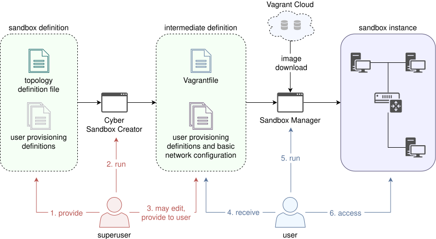

# Cyber Sandbox Creator

Cyber Sandbox Creator is a tool, which can generate portable input files for building lightweight virtual environments using Vagrant and Ansible from a simple YAML definition of topology. The combination of these three tools makes possible to build virtual machines connected with virtual networks even on a desktop computer.

## Installation

**Note:** This is just a quick guide how to install and generate files with this tool. For full description of how to prepare the host device to be able run the generated environments and how to build the virtual machines check our [wiki page](https://gitlab.ics.muni.cz/cs4eu/sandbox-creator/-/wikis/Installation-and-Usage).

### Linux (Ubuntu/Debian)

1. Install git using the command `$ sudo apt-get install git`.
2. Clone the project with `$ git clone https://gitlab.ics.muni.cz/cs4eu/sandbox-creator.git` to an arbitrary directory.
3. Navigate to the project directory (`$ cd sandbox-creator`).
4. Install pip using `$ sudo apt-get install python3-pip`.
5. Install setuptools with `$ pip3 install setuptools`.
6. Install dependencies with the command `$ pip3 install -r requirements.txt`.

### Windows 10

1. Install [Python 3](https://www.python.org/downloads/windows/). At the beginning of the installation mark the "Add Python to PATH" option.
2. Install [git](https://git-scm.com/downloads).
3. Clone the project with `git clone https://gitlab.ics.muni.cz/cs4eu/sandbox-creator.git` to an arbitrary folder.
4. Navigate to the project folder (`cd sandbox-creator`).
5. Install Python dependencies using the command `python -m pip install -r .\requirements.txt`.

## Usage

### Linux (Ubuntu/Debian)

1. After the installation simply run the command `$ python3 create.py topology.yml` to generate files.
2. Navigate to the newly created directory `sandbox` and run `$ vagrant up` to build the virtual environment.
3. The built environment can be deleted using the command `$ vagrant destroy -f`.

### Windows 10

1. Generate files using the command `python create.py --ansible_local topology.yml`.
2. Navigate to the newly created folder `sandbox` and run the command `vagrant up` to build the virtual environment.
3. The built environment can be deleted using the command `vagrant destroy -f`.

## Credits

**Cybersecurity Laboratory**\
**Faculty of Informatics**\
**Masaryk University**

**Lead developer**: Attila Farkas

**Technology lead**: Daniel Tovarňák (KYPO cyber range platform)

**Supervisor**: Jan Vykopal

**Contributors**:

- Valdemar Švábenský
- Kamil Andoniadis (KYPO cyber range platform)
- Michal Staník
- Zdeněk Vydra
- Adam Skrášek

## License

This project is licensed under the MIT License - see the LICENSE file for details.
